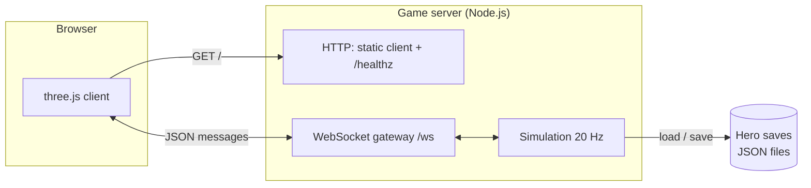
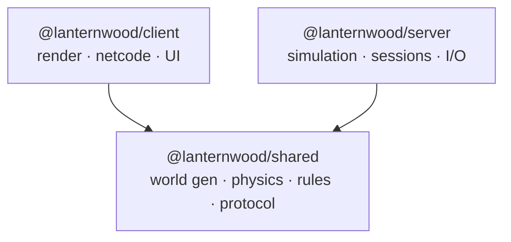
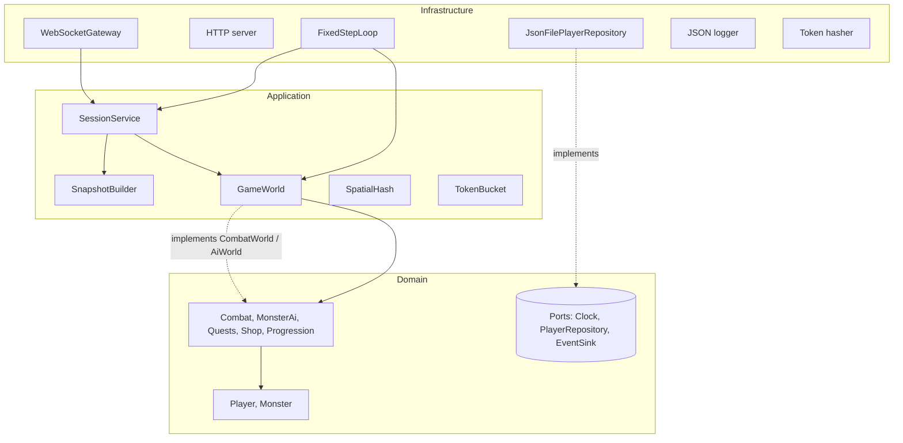
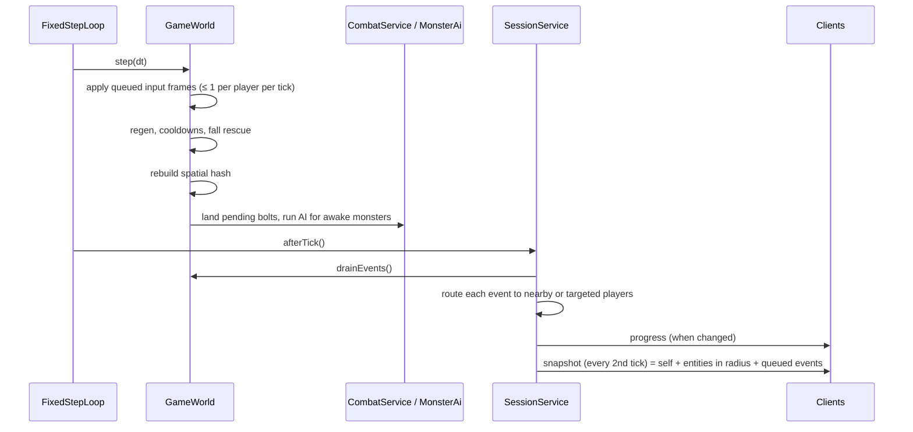
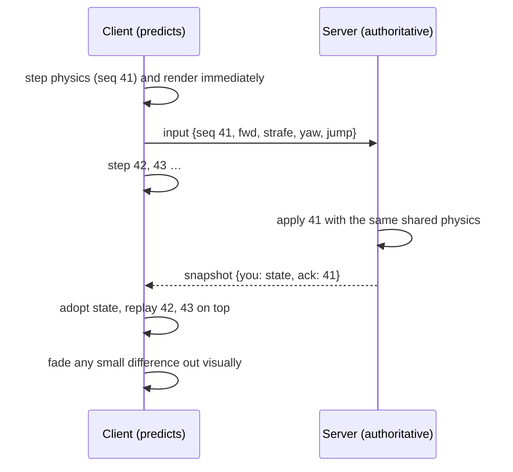

# Architecture

This document explains how Lanternwood Realms is put together and why. Decisions with real trade-offs are recorded in [`adr/`](adr/).

## 1. Goals

1. **The server is the authority.** Clients send intent; only the server decides positions, damage, loot and progress.
2. **The game feels responsive at 100–200 ms latency.** Your own movement is predicted locally; everyone else is smoothly interpolated.
3. **Rules live in one place.** Physics, world generation and game data are shared code, so client and server cannot disagree.
4. **Every layer is testable on its own.** The domain has no I/O; infrastructure is behind ports; the composition root boots the real server in-process for end-to-end tests.

## 2. System context



One process serves the static client, the WebSocket endpoint and a health probe. Heroes are stored behind a repository port, so the JSON file adapter can be swapped for a database without touching game logic.

## 3. Packages



| Package | Depends on | Runs in | Contains |
| --- | --- | --- | --- |
| `shared` | nothing | Node and browser | Seeded noise and RNG, voxel world and generator, chunk mesher, player physics, stats/skills/monsters/quests/economy data, protocol types, validation and sanitisers |
| `server` | `shared`, `ws` | Node | The authoritative game server |
| `client` | `shared`, `three` | Browser | Rendering, input, prediction, interpolation, HUD |

`shared` exports TypeScript source. tsx, Vite and esbuild compile it as part of whichever side imports it, so there is no separate build step and no risk of a stale build.

## 4. Server layers

The server follows a ports-and-adapters (hexagonal) layout. Dependencies only point inward, and ESLint (`no-restricted-imports` in `eslint.config.js`) fails the build if one points outward.



| Layer | Folder | Rules |
| --- | --- | --- |
| Domain | `src/domain` | Pure game logic: entities, services, results and events. No Node APIs, no sockets, no files. Talks to the world through interfaces it defines (`CombatWorld`, `AiWorld`, `EventSink`, `Clock`). |
| Application | `src/application` | Use cases and orchestration. `GameWorld` owns all entities and runs a tick; `SessionService` turns transport messages into commands and routes events back out. Depends on ports (`ClientLink`, `Logger`, `SystemTime`, `PlayerRepository`), never on adapters. |
| Infrastructure | `src/infrastructure` | Adapters: `ws` gateway, HTTP static server, JSON-file and in-memory repositories, fixed-step scheduler, logger, token hashing. |
| Composition | `src/app.ts`, `src/main.ts`, `src/config.ts` | `createGameServer` wires everything; `main.ts` adds config, signals and process lifetime. |

## 5. The tick

`FixedStepLoop` runs the simulation in equal 50 ms steps with an accumulator, so OS timer jitter never changes game behaviour. It catches up at most five steps per wake, and a step that throws is logged and skipped rather than crashing the server.



- **Sleeping monsters.** Monsters more than 90 blocks from every player skip AI entirely.
- **Area of interest.** A `SpatialHash` with 16-block cells answers "who is near?" in a few cell lookups. Each player only receives entities and events within `INTEREST_RADIUS`.
- **Backpressure.** If a socket has more than 512 KB queued, that client skips snapshots and its events wait for the next one. A slow phone never slows the server down.

## 6. Netcode

### Movement: prediction and reconciliation



- Client and server both run `stepPlayer` from `shared` at `SIM_DT = 1/20 s`. Same code and same inputs give the same result, so reconciliation is usually a no-op (`packages/client/test/netcode.test.ts` proves it converges).
- **Speed-hack guard.** Each player earns one input credit per tick (capped at six). Extra frames wait in the queue or are dropped. Replayed or out-of-order sequence numbers are ignored. A client cannot move faster than real time, however many frames it sends.
- Players are simulated only when their frames arrive. A backgrounded tab simply stands still.

### Everyone else: interpolation

Snapshots carry the server time `st`. `ClockSync` estimates the offset to the local clock, and each remote entity is drawn at `serverNow − 200 ms` by blending the two snapshots around that moment (`SnapshotBuffer`). Small extrapolation covers a late packet; beyond that the entity holds still rather than guessing.

### Actions

Skills, NPC actions, chat and respawn are discrete commands. The client shows cosmetic feedback at once (the sword swing, the cooldown sweep). The server validates level, cooldown, mana, range and NPC distance, applies the result, and reports it through events: damage numbers, deaths, level-ups, toasts and log lines. Ember Bolt damage lands after its real flight time.

### World data

The world is never sent. The server sends only its seed, and the client runs the same `generateWorld(seed)`, which takes about 0.2 s. Chunks are meshed a few per frame with face culling and per-vertex ambient occlusion.

## 7. Security

| Threat | Mitigation |
| --- | --- |
| Malformed or hostile messages | `parseClientMessage` checks the exact shape, range and type of every field; strings are sanitised; payloads over 8 KB are rejected at the socket and again before parsing. |
| Floods | Per-connection token buckets for all messages (burst 80, 50/s) and for chat (burst 5, one per 2 s). Repeated violations close the connection with code 4400. |
| Speed and teleport hacks | Input credit, sequence checks, clamped intents; positions are only ever computed by the server. |
| Cheating on combat or economy | The server validates every skill (cooldown, mana, unlock level, range, line of reach) and every NPC action (distance, gold). |
| Stolen identities in logs or saves | Guest tokens are 256-bit secrets kept in the browser. Only a salted SHA-256 hash becomes the account id, and logs show just 8 characters of it. |
| Path traversal in static files | Paths are decoded, NUL-checked and resolved, and must stay inside the client directory. Tested end to end. |
| XSS through names or chat | Names and chat are sanitised on the server, and the client inserts all text with `textContent`, never HTML. A strict CSP is sent with every page. |
| Cross-site socket use | Optional `ALLOWED_ORIGINS` allow-list on the WebSocket upgrade. |
| Duplicate sessions | Joining with a hero that is already online signs out the older window (code 4409) after saving it. |

## 8. Persistence

`PlayerRepository` is a domain port with two adapters:

- **`JsonFilePlayerRepository`** writes one file per hero. Each write goes to a temp file and is renamed into place, so a crash cannot corrupt a save. Writes for the same account are serialised, and a corrupt or out-of-range file is refused instead of overwritten.
- **`InMemoryPlayerRepository`** is used by tests.

Heroes are saved when they leave, every `AUTOSAVE_SECONDS`, and on graceful shutdown (SIGINT or SIGTERM, with a 10-second hard timeout).

## 9. Client structure

```
src/app/      GameClient (state machine + frame loop), identity, server URL
src/net/      Connection: typed WebSocket wrapper
src/state/    LocalPlayer (prediction), EntityStore + SnapshotBuffer (interpolation), ClockSync
src/input/    Keyboard, touch joystick, pointer camera (drag, pinch, tap-to-target)
src/render/   SceneContext, TerrainRenderer, SkySystem, EntityViews + models, Effects, CameraRig
src/ui/       HUD, minimap, nameplates and floating text, dialogs, chat, notices, title screen
```

State and net code have no three.js or DOM dependencies, so they are unit-tested in Node. `GameClient` is the only place where network, input, state and views meet.

## 10. Observability

- Logs are one JSON object per line (`time`, `level`, `message`, `component`, plus fields), ready for any log shipper.
- `GET /healthz` reports players, connections, the current tick and loop statistics (average and maximum step time, lag resets, step errors). Use it for container health checks and alerting.

## 11. Scaling path

The current design targets one process with up to a few hundred players. The ports make the next steps local changes:

1. **Database persistence.** Implement `PlayerRepository` for Postgres or Redis. No other code changes.
2. **Binary protocol.** Swap `encodeMessage`/`decodeServerMessage` for a binary codec with delta-compressed snapshots. Message shapes stay the same.
3. **Sharding by zone.** Run one `GameWorld` per zone or realm instance behind a gateway that hands players over at zone borders. `GameWorld` already owns everything about one simulation and nothing about transport.
4. **Real accounts.** Replace guest tokens with an auth service that issues signed tokens. Only `hashToken` and the hello handshake change.

## 12. Testing strategy

| Level | Where | Examples |
| --- | --- | --- |
| Unit | `packages/*/test` | Physics collisions, protocol validation, token bucket, spatial hash, snapshot interpolation |
| Domain / application | `server/test/combat`, `game-world`, `session-service` | Quest chain end to end, monster leashing, speed-hack guard, duplicate login, full server |
| Integration | `server/test/infrastructure` | Atomic JSON saves, config validation |
| End to end | `server/test/e2e` | Real HTTP and WebSocket server; two clients join, see each other move, and chat; path traversal blocked |
