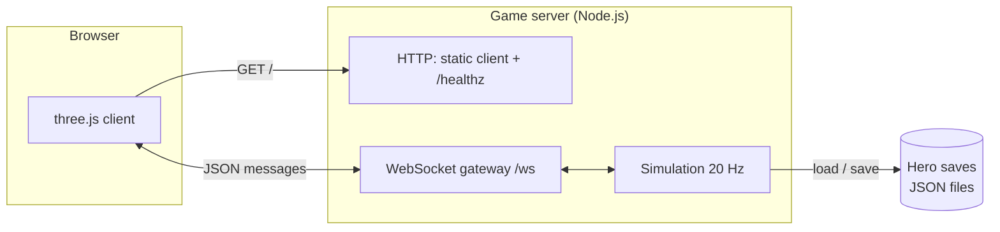
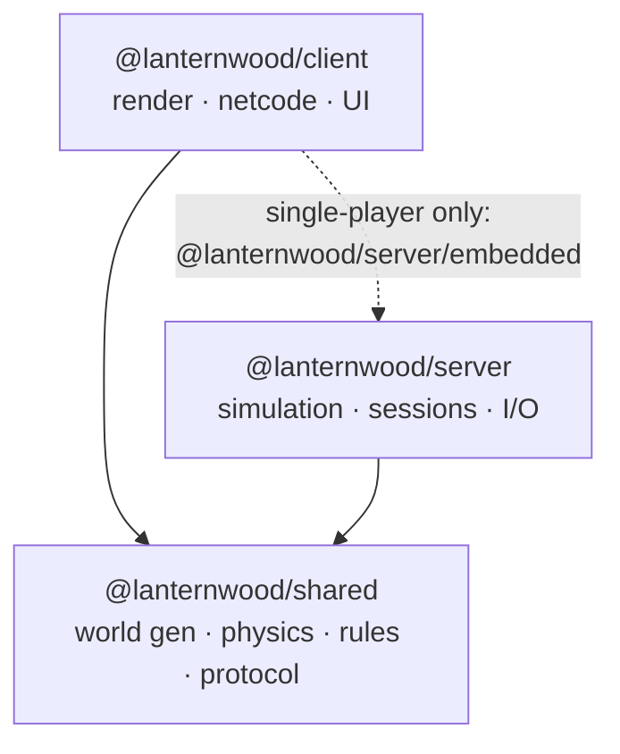
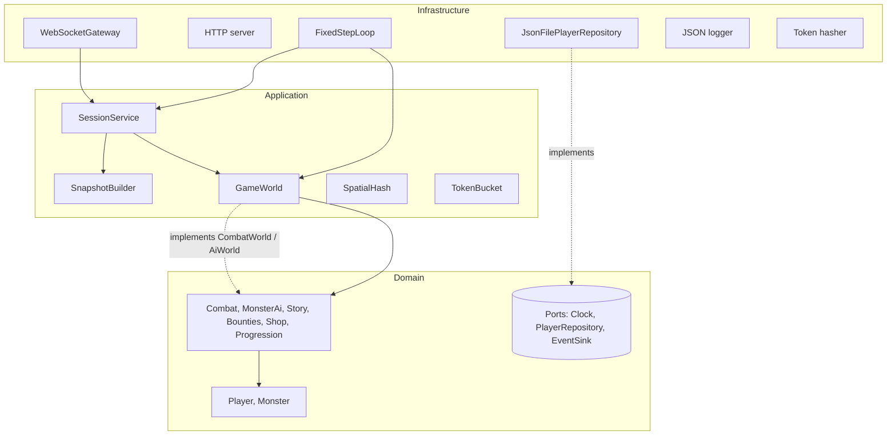
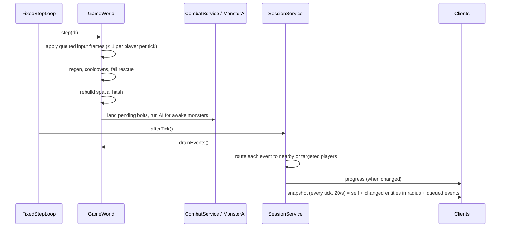
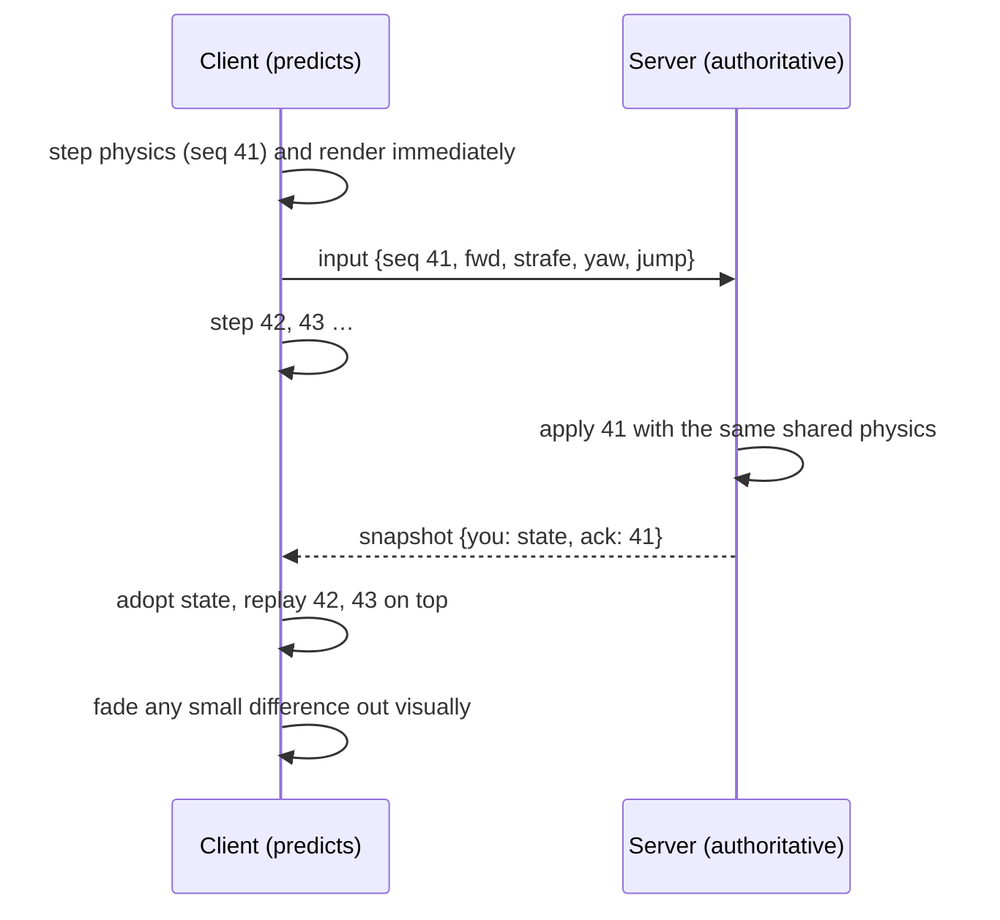
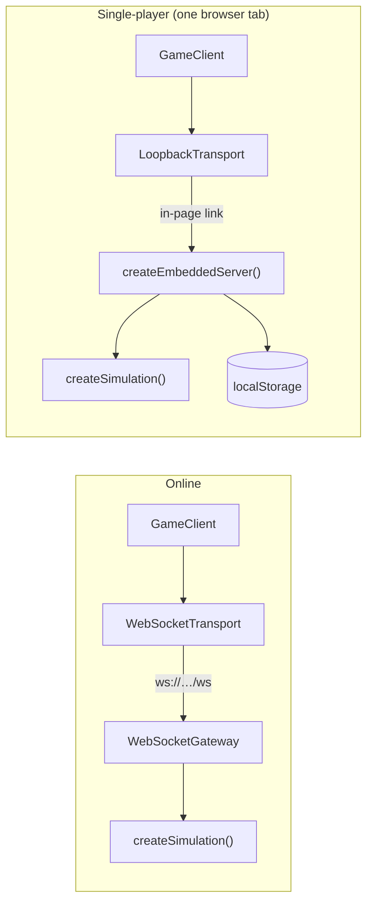

# Architecture

This document explains how Lanternwood Realms is put together and why. Decisions with real trade-offs are recorded in [`adr/`](adr/).

## 1. Goals

1. **The server is the authority.** Clients send intent; only the server decides positions, damage, loot and progress.
2. **The game feels responsive at 100–200 ms latency.** Your own movement is predicted locally; everyone else is smoothly interpolated.
3. **Rules live in one place.** Physics, world generation and game data are shared code, so client and server cannot disagree.
4. **Every layer is testable on its own.** The domain has no I/O; infrastructure is behind ports; the composition root boots the real server in-process for end-to-end tests.

## 2. System context



One process serves the static client, the WebSocket endpoint and a health probe. Heroes are stored behind a repository port, so the JSON file adapter can be swapped for a database without touching game logic.

## 3. Packages



| Package | Depends on | Runs in | Contains |
| --- | --- | --- | --- |
| `shared` | nothing | Node and browser | Seeded noise and RNG, voxel world and generator, chunk mesher, player physics, stats, skills, monsters, story scripts, bounties and economy data, protocol types, validation and sanitisers |
| `server` | `shared`, `ws` | Node | The authoritative game server |
| `client` | `shared`, `three`, `server/embedded` | Browser | Rendering, input, prediction, interpolation, HUD, transports |

The client may import only the server's `embedded` entry point (enforced by the server's package `exports`), and only for single-player mode (section 7).

`shared` exports TypeScript source. tsx, Vite and esbuild compile it as part of whichever side imports it, so there is no separate build step and no risk of a stale build.

## 4. Server layers

The server follows a ports-and-adapters (hexagonal) layout. Dependencies only point inward, and ESLint (`no-restricted-imports` in `eslint.config.js`) fails the build if one points outward.



| Layer | Folder | Rules |
| --- | --- | --- |
| Domain | `src/domain` | Pure game logic: entities, services, results and events. No Node APIs, no sockets, no files. Talks to the world through interfaces it defines (`CombatWorld`, `AiWorld`, `EventSink`, `Clock`). |
| Application | `src/application` | Use cases and orchestration. `GameWorld` owns all entities and runs a tick; `SessionService` turns transport messages into commands and routes events back out. Depends on ports (`ClientLink`, `Logger`, `SystemTime`, `PlayerRepository`), never on adapters. |
| Infrastructure | `src/infrastructure` | Adapters: `ws` gateway, HTTP static server, JSON-file and in-memory repositories, fixed-step scheduler, logger, token hashing. |
| Composition | `src/app.ts`, `src/main.ts`, `src/config.ts` | `createGameServer` wires everything; `main.ts` adds config, signals and process lifetime. |

## 5. The tick

`FixedStepLoop` runs the simulation in equal 50 ms steps with an accumulator, so OS timer jitter never changes game behaviour. It catches up at most five steps per wake, and a step that throws is logged and skipped rather than crashing the server.



- **Sleeping monsters.** Monsters more than 90 blocks from every player skip AI entirely.
- **Area of interest.** A `SpatialHash` with 16-block cells answers "who is near?" in a few cell lookups. Each player only receives entities and events within `INTEREST_RADIUS`.
- **Backpressure.** If a socket has more than 512 KB queued, that client skips snapshots and its events wait for the next one. A slow phone never slows the server down.

## 6. Netcode

### Movement: prediction and reconciliation



- Client and server both run `stepPlayer` from `shared` at `SIM_DT = 1/20 s`. Same code and same inputs give the same result, so reconciliation is usually a no-op (`packages/client/test/netcode.test.ts` proves it converges).
- **Input credit.** Each player earns one frame of credit per tick of real time. Credit banks up to one second (`MAX_INPUT_CREDIT`), and new players start with four frames. Input delayed by network jitter or a short stall is applied as soon as it arrives instead of queueing behind newer input, so there is no lasting input delay. Over any window, nobody can move faster than real time.
- **Stale input is dropped.** Frames still waiting after credit runs out (more than `MAX_INPUT_BACKLOG`, four) are skipped and acknowledged. A long stall then costs one small correction rather than permanent lag for everyone watching. Replayed or out-of-order sequence numbers are ignored.
- Players are simulated only when their frames arrive. A backgrounded tab simply stands still.

### Everyone else: interpolation

Snapshots go out every tick (20 per second) and carry the server time `st`. `ClockSync` estimates the offset to the local clock. Each remote entity is drawn a little in the past, blending the two snapshots around that moment (`SnapshotBuffer`).

The **render delay adapts** to the connection: it is the snapshot spacing plus the 95th-percentile lateness of recent snapshots, clamped to 50–300 ms and eased so entities never jump in time. That comes to about 60 ms on a steady connection, against a fixed 200 ms before. Small extrapolation covers a late packet; beyond that the entity holds still rather than guessing.

### Snapshot deltas

Snapshots are delta-encoded per viewer (`SnapshotBuilder` remembers what each viewer was last sent):

- An entity appears in full once.
- After that, only the fields that changed are sent; an entity that changed nothing is left out.
- `gone` lists entities that left the area of interest.

TCP delivers in order, so patches always apply to the previous snapshot. This cut a typical snapshot near town from about 7 KB to about 1.2 KB, so 20 snapshots a second use less bandwidth than 10 full ones did.

### Measured latency

`packages/server/scripts/net-probe.ts` measures a running server with bots. The **Live probe** workflow runs it, plus two real browsers, against the deployed server; the **Load test** workflow runs it at increasing player counts. On the Render deployment, before this design (10 full snapshots/s, a fixed 200 ms render delay, a six-frame credit cap), one player saw another start moving about 167 ms after the input left, plus 200 ms of render delay. See `docs/CAPACITY.md` for current figures.

### Actions

Skills, NPC actions, chat and respawn are discrete commands. The client shows cosmetic feedback at once (the sword swing, the cooldown sweep). The server validates level, cooldown, mana, range and NPC distance, applies the result, and reports it through events: damage numbers, deaths, level-ups, toasts and log lines. Ember Bolt damage lands after its real flight time.

### World data

The world is never sent. The server sends only its seed, and the client runs the same `generateWorld(seed)`, which takes about 0.2 s. Chunks are meshed a few per frame with face culling and per-vertex ambient occlusion.

### Game modes

Four modes live in `server/src/application/modes/`: `EmberRun`, `LanternNight`, `RiftTrials` and `Duels`. Each implements `GameMode`: a `step` each tick, the hero's `status` for their HUD, and optional rule hooks (`skillBlocked`, `mountBlocked`, `ignoredByMonsters`, `frozen`, `onPlayerFell`, `onPlayerRemoved`). A mode changes the world only through `ModeHost` (teleport, rewards, achievements, leaderboards). Combat, monster AI and mounts ask the world for those rules instead of knowing about any mode (ADR 0011). Two rules reach into the domain without naming a mode: rift monsters carry their party and fight only it (`sameFight`), and a hero can hit another hero only while `CombatWorld.duelOpponent` says they are duelling (ADR 0012). Results go to `Leaderboards`, which keeps the boards in memory and writes them through a `LeaderboardRepository` (a JSON file online, localStorage in single-player).

## 7. Play modes: online and single-player

The client reaches a server through one `Transport` interface. Everything above it is identical in both modes: prediction, reconciliation, interpolation, the HUD and the protocol messages, which stay JSON text in both.



- `createSimulation()` (`server/src/simulation.ts`) builds the world, the session service and the fixed-step loop. It has no Node APIs, and ESLint keeps it that way.
- The **online server** (`app.ts`) adds HTTP, the WebSocket gateway, JSON-file saves and autosave.
- The **embedded server** (`embedded.ts`) adds a loopback link, a browser storage repository and a single-player limit. Because it is the same authoritative code, single-player mode also checks every rule that matters online.
- `resolvePlayMode` picks the mode: `?offline` forces single-player, `?server=` forces online, and otherwise the build decides (`npm run build:preview` makes the single-player bundle).

## 8. Security

| Threat | Mitigation |
| --- | --- |
| Malformed or hostile messages | `parseClientMessage` checks the exact shape, range and type of every field; strings are sanitised; payloads over 8 KB are rejected at the socket and again before parsing. |
| Floods | Per-connection token buckets for all messages (burst 80, 50/s) and for chat (burst 5, one per 2 s). Repeated violations close the connection with code 4400. |
| Speed and teleport hacks | Input credit, sequence checks, clamped intents; positions are only ever computed by the server. |
| Cheating on combat or economy | The server validates every skill (cooldown, mana, unlock level, range, line of reach) and every NPC action (distance, gold). |
| Stolen identities in logs or saves | Guest tokens are 256-bit secrets kept in the browser. Only a salted SHA-256 hash becomes the account id, and logs show just 8 characters of it. |
| Path traversal in static files | Paths are decoded, NUL-checked and resolved, and must stay inside the client directory. Tested end to end. |
| XSS through names or chat | Names and chat are sanitised on the server, and the client inserts all text with `textContent`, never HTML. A strict CSP is sent with every page. |
| Cross-site socket use | Optional `ALLOWED_ORIGINS` allow-list on the WebSocket upgrade. |
| Duplicate sessions | Joining with a hero that is already online signs out the older window (code 4409) after saving it. |

## 9. Persistence

`PlayerRepository` is a domain port with three adapters:

- **`JsonFilePlayerRepository`** writes one file per hero. Each write goes to a temp file and is renamed into place, so a crash cannot corrupt a save. Writes for the same account are serialised, and a corrupt or out-of-range file is refused instead of overwritten.
- **`InMemoryPlayerRepository`** is used by tests.
- **`LocalStoragePlayerRepository`** (client) keeps single-player heroes in the browser, falling back to memory when storage is blocked.

Heroes are saved when they leave, every `AUTOSAVE_SECONDS`, and on graceful shutdown (SIGINT or SIGTERM, with a 10-second hard timeout).

## 10. Client structure

```
src/app/      GameClient (state machine + frame loop), identity, play mode, server URL
src/net/      Transport interface; WebSocketTransport (online), LoopbackTransport (single-player)
src/offline/  Browser adapters for the embedded server: localStorage saves, clock
src/state/    LocalPlayer (prediction), EntityStore + SnapshotBuffer (interpolation), ClockSync
src/input/    Keyboard, touch joystick, pointer camera (drag, pinch, tap-to-target)
src/render/   SceneContext, TerrainRenderer, SkySystem, EntityViews + models, Effects, CameraRig
src/ui/       HUD, minimap, nameplates and floating text, dialogs, chat, notices, title screen
```

State and net code have no three.js or DOM dependencies, so they are unit-tested in Node. `GameClient` is the only place where network, input, state and views meet.

## 11. Observability

- Logs are one JSON object per line (`time`, `level`, `message`, `component`, plus fields), ready for any log shipper.
- `GET /healthz` reports players, connections, the current tick and loop statistics (average and maximum step time, lag resets, step errors). Use it for container health checks and alerting.

## 12. Scaling path

The current design targets one process with up to a few hundred players. The ports make the next steps local changes:

1. **Database persistence.** Implement `PlayerRepository` for Postgres or Redis. No other code changes.
2. **Binary protocol.** Swap `encodeMessage`/`decodeServerMessage` for a binary codec with delta-compressed snapshots. Message shapes stay the same.
3. **Sharding by zone.** Run one `GameWorld` per zone or realm instance behind a gateway that hands players over at zone borders. `GameWorld` already owns everything about one simulation and nothing about transport.
4. **Real accounts.** Replace guest tokens with an auth service that issues signed tokens. Only `hashToken` and the hello handshake change.

## 13. Testing strategy

| Level | Where | Examples |
| --- | --- | --- |
| Unit | `packages/*/test` | Physics collisions, protocol validation, token bucket, spatial hash, snapshot interpolation |
| Domain / application | `server/test/combat`, `game-world`, `session-service` | Story chains end to end, daily bounties, save migration, each mode end to end on a fake clock (a race, a night won and lost, a full rift run, duels), mounts and pets, monster leashing, speed-hack guard, duplicate login, full server |
| Integration | `server/test/infrastructure` | Atomic JSON saves, config validation |
| End to end | `server/test/e2e`, `client/test/offline` | Real HTTP and WebSocket server; two clients join, see each other move, and chat; two clients fight a duel to a rating change; path traversal blocked; single-player through the in-page server |
| Browser (CI) | `scripts/browser-smoke.mjs` | Headless Chromium with WebGL: two players in the online build see each other move and chat; the preview bundle renders and plays, opens the journal and the stable, and starts and gives up an Ember Run |
| Container (CI) | `.github/workflows/ci.yml` | Docker image builds, starts, answers `/healthz` and serves the client |

## 14. Deployment

`render.yaml` describes the online server as a Render web service built from the Dockerfile, with `/healthz` as its health check. The **Deploy** workflow ships each push to `main` that passes CI: it triggers a Render deploy hook for that exact commit, waits until `/healthz` reports the commit, and then runs the live probe against it (ADR 0008). The Dockerfile works on any container host; set `PORT`, and mount a persistent volume at `/data` to keep heroes across restarts.
